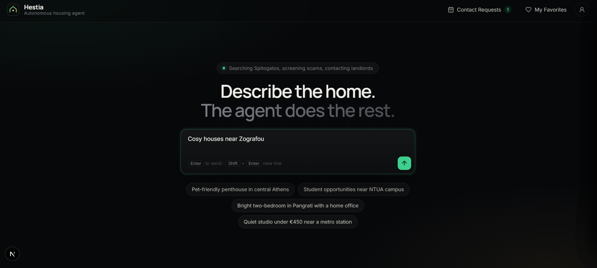
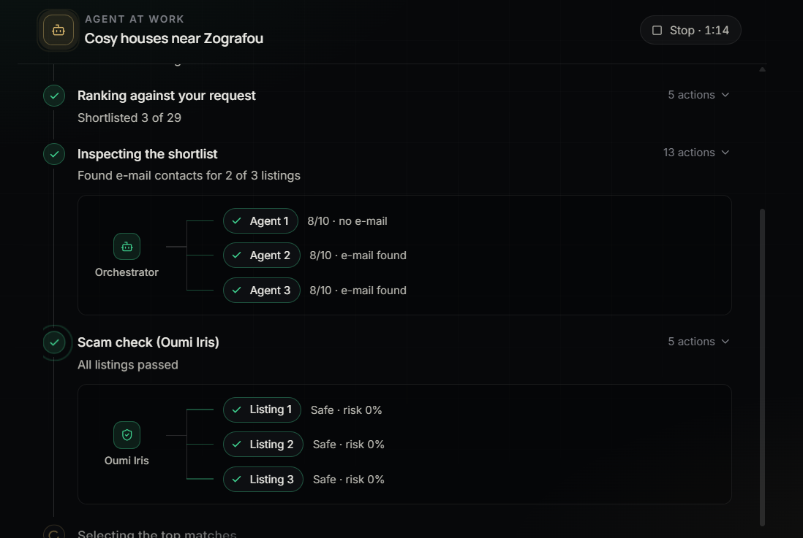
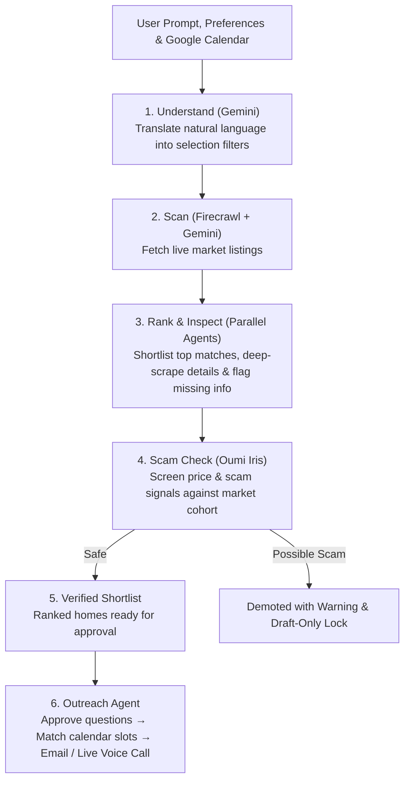

# Hestia — Autonomous Housing Agent

_The home you need, found, verified, and booked — before your coffee gets cold. Stop hunting. Start moving. That's Hestia._

## Problem Statement

House hunting is a second job — endless scrolling, rental scams, and wasted time on phone calls. Hestia deploys a team of AI agents that find, verify, and book viewings for you.

## Why Hestia

- **Search, inspect & rank** — Parallel agents scour portals, marketplaces, and social feeds so no opportunity is missed, then deep-dive each listing to return a scored shortlist with match breakdown, pros, cons, and the questions you'd actually want answered.
- **Scam defense** — Oumi’s `Iris` Decision Model screens every shortlisted home against neighborhood pricing and flags suspected scams before you ever reach out.
- **Human-in-the-loop outreach** — Approve questions, match your Google Calendar, and send tailored requests via email or live AI voice call.

## Walkthrough

### 1. Natural-Language Prompt

Describe your ideal home in one sentence and save your profile + Google Calendar iCal URL once in **Settings**.



### 2. Live Multi-Agent Pipeline & Swarm Graph

Hestia streams every stage in real , visualizing parallel sub-agents under **Orchestrator** and **Oumi Iris** hubs.



### 3. Verified Property Cards (`Live data` + `Oumi Iris`)

Each finalist shows an overall match score, authentic photos, an **`Oumi Iris · Safe / Possible scam`** badge, **Details** (5-metric breakdown + gallery + open questions), and **Ask Agent to Contact**.


### 4. Human-in-the-Loop Outreach & Scheduling

Clicking **Ask Agent to Contact** lets you review or edit the agent's questions, checks your **Google Calendar** for conflict-free evening/weekend slots, verifies the landlord's email, drafts/sends via **Resend**, and includes an interactive **live LLM voice-call** demo (ready to route over **Twilio Voice** in production).


---

## Docs & Architecture

- **Backend (`backend/`):** FastAPI pipeline (`agent.py`), Oumi Iris gate ([`OUMI_IRIS_INTEGRATION.md`](./OUMI_IRIS_INTEGRATION.md)), photo proxy (`photos.py`), and outreach engine ([`OUTREACH.md`](./OUTREACH.md)).
- **Frontend (`frontend/`):** Next.js 15 live agent feed, swarm graph, cards & outreach workspace ([`FRONTEND.md`](./FRONTEND.md)).

---

## Agent-Ready API

Other agents can use Hestia too, not just people. Each stage of the pipeline is its own stateless JSON endpoint, so an agent can call the one tool it needs without running the whole flow. A **negotiator agent**, for example, can get verified comparables and a scam verdict before it makes an offer.

| Tool | Endpoint | Input → Output | Typical caller |
| --- | --- | --- | --- |
| **House search** | `POST /api/search` | `{request}` (natural language) → ranked, scored listings | Relocation / concierge agents |
| **Live search** | `POST /api/search/stream` | Same, streamed as NDJSON progress events | Agents with live UIs |
| **Scam check** | `POST /api/decision/evaluate` | `{properties, cohort?}` → verdict, risk %, reason | Negotiator / due-diligence agents |
| **Contact extraction** | `POST /api/outreach/extract` | listings → landlord phones & emails | CRM / lead agents |
| **Draft outreach** | `POST /api/outreach/preview` | listings + context → composed messages (dry run) | Negotiator agents |
| **Send outreach** | `POST /api/outreach/send` | approved listings → email / SMS sent | Booking agents |
| **Book a viewing** | `POST /api/outreach/stream` | one listing + iCal URL → free slots, draft, send | Scheduling agents |

- **Discoverable:** the OpenAPI schema at `/openapi.json` (interactive docs at `/docs`) can be loaded directly as tool definitions, or wrapped as an MCP server.
- **Composable:** a typical negotiator chain is `search` → `decision/evaluate` → `outreach/preview` → `outreach/send`.
- **Safe by default:** `preview` never sends anything, and listings flagged as possible scams stay draft-only.

---

## Pipeline



---

## Quickstart

```powershell
# 1. Configure environment & verify live API keys
Copy-Item .env.example .env
uv run python -m backend.check_env

# 2. Start Backend (http://localhost:8000)
.\run.ps1

# 3. Start Frontend (http://localhost:3000)
cd frontend && npm install && npm run dev
```

### Checks

```powershell
uv run ruff check .
uv run pytest -v
cd frontend && npm run format:check && npm run typecheck && npm run build
```
