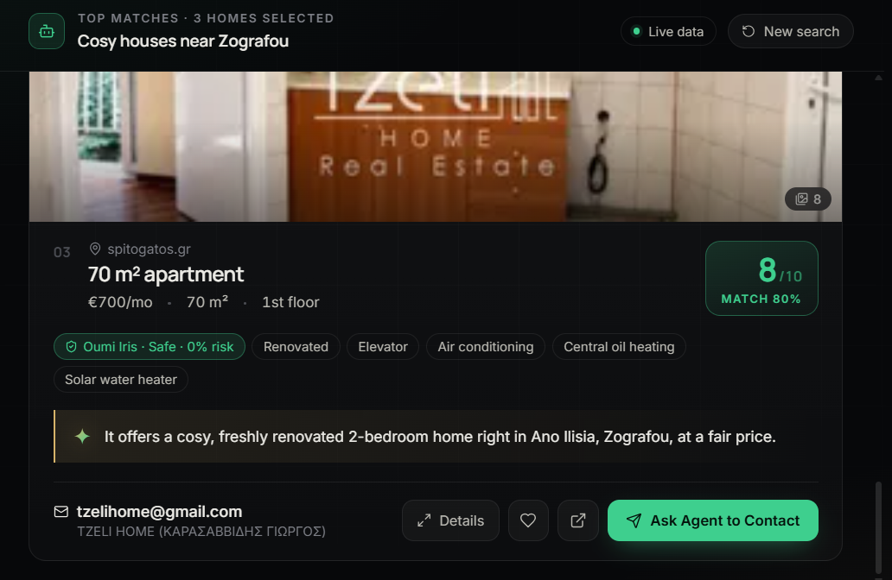
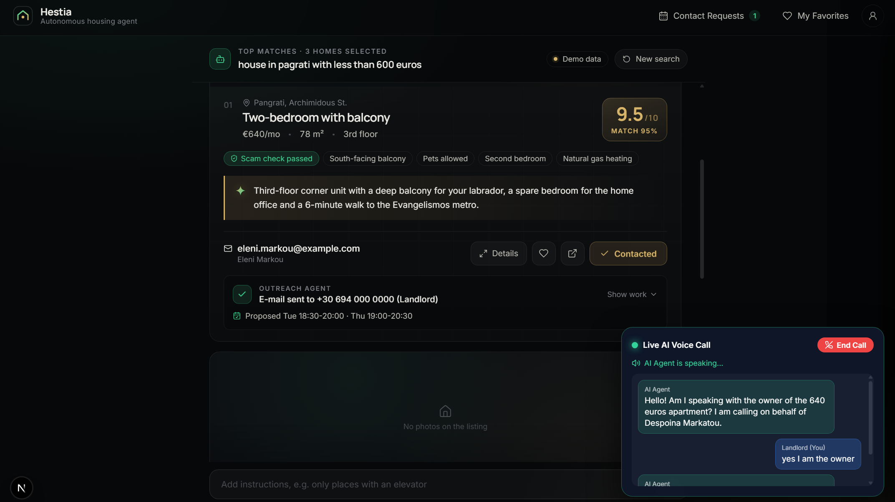
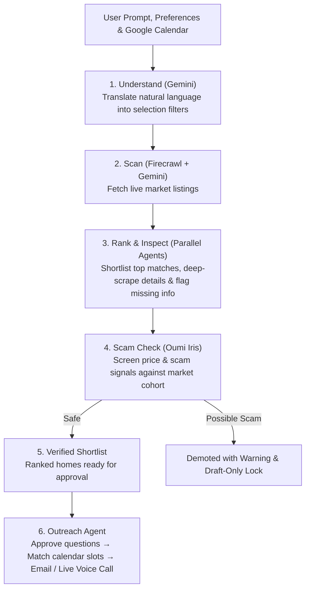

# Hestia — Autonomous Housing Agent

> **Describe the home. The agent does the rest.**  
>  **Hestia** turns a natural language prompt into  apartment matches from **real, live market data**, while at the same time checking their legitimacy. The app was designed to follow a human-in-the-loop architecture so that humans can always audit who/how the agent conctacts the landlords.
---

## Why Hestia

- **Real, live market data:** Scrapes live portals on demand via **Firecrawl** + **Gemini**—evaluating real listings, photos, €/m² cohort pricing, and landlord contacts (with automatic offline fallback only if the backend is down).
- **Post-ranker scam defense (`Oumi Iris`):** Underpriced bait listings often rank #1 on portals. **Oumi's `Iris` Decision Model** screens shortlisted homes against real neighborhood pricing and flags/demotes suspected scams (`≥ 50%` risk).
- **Human-in-the-loop outreach:** You stay in control—approve or add questions (`missing_info`), match conflict-free **Google Calendar** viewing slots, and send tailored requests via **Resend** email (or preview a **live LLM voice-call** mockup), while flagged scams stay **locked to draft-only**.


## Walkthrough

### 1. Natural-Language Prompt
Describe your ideal home in one sentence and save your profile + Google Calendar iCal URL once in **Settings**.


### 2. Live Multi-Agent Pipeline & Swarm Graph
Hestia streams every stage in real , visualizing parallel sub-agents under **Orchestrator** and **Oumi Iris** hubs.


### 3. Verified Property Cards (`Live data` + `Oumi Iris`)
Each finalist shows an overall match score, authentic photos, an **`Oumi Iris · Safe / Possible scam`** badge, **Details** (5-metric breakdown + gallery + open questions), and **Ask Agent to Contact**.



### 4. Human-in-the-Loop Outreach & Scheduling
Clicking **Ask Agent to Contact** lets you review or edit the agent's questions, checks your **Google Calendar** for conflict-free evening/weekend slots, verifies the landlord's email, drafts/sends via **Resend**, and includes an interactive **live LLM voice-call** demo (ready to route over **Twilio Voice** in production).



---

## Docs & Architecture

- **Backend (`backend/`):** FastAPI pipeline (`agent.py`), Oumi Iris gate ([`OUMI_IRIS_INTEGRATION.md`](./OUMI_IRIS_INTEGRATION.md)), photo proxy (`photos.py`), and outreach engine ([`OUTREACH.md`](./OUTREACH.md)).
- **Frontend (`frontend/`):** Next.js 15 live agent feed, swarm graph, cards & outreach workspace ([`FRONTEND.md`](./FRONTEND.md)).

---

---

## Pipeline



---

## Quickstart

```powershell
# 1. Configure environment & verify live API keys
Copy-Item .env.example .env
uv run python -m backend.check_env

# 2. Start Backend (http://localhost:8000)
.\run.ps1

# 3. Start Frontend (http://localhost:3000)
cd frontend && npm install && npm run dev
```

### Checks

```powershell
uv run ruff check .
uv run pytest -v
cd frontend && npm run format:check && npm run typecheck && npm run build
```
